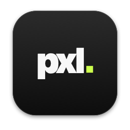

<p align="center">
  
</p>

<h1 align="center">pxl</h1>

<p align="center">
  <b>Every PXLVZN app, in one place.</b><br>
  Install, open and update Dwn, Tag and everything that comes next, from one window.<br>
  For macOS and Windows.
</p>

<p align="center">
  <a href="https://github.com/YuvrajxGarg/pxl/releases/latest"></a>
  
  <a href="LICENSE"></a>
</p>

## Download

| Platform | Download | First launch |
|---|---|---|
| **macOS** 11+ | [**PXL.dmg**](https://github.com/YuvrajxGarg/pxl/releases/latest/download/PXL.dmg) | Open it and drag **PXL** to Applications. It isn't notarized, so the first time: right-click → **Open** (on macOS 15+, **System Settings → Privacy & Security → Open Anyway**). |
| **Windows** 10 / 11 · 64-bit | [**PXL-Setup.exe**](https://github.com/YuvrajxGarg/pxl/releases/latest/download/PXL-Setup.exe) | Run the setup. It installs PXL for your account (no admin needed) and adds it to the Start menu. If SmartScreen appears: **More info → Run anyway**. |

## What it does

- **Discover** every app, with screenshots, release notes and what it runs on.
- **One-click installs.** PXL downloads the app from its GitHub release, checks the SHA-256 checksum, and installs it: into Applications on a Mac, into `%LOCALAPPDATA%\Programs` (with a Start menu shortcut) or through the app's own installer on Windows.
- **Updates.** New versions of every installed app show up under **Updates**. With automatic updates on, they install in the background while the app is closed. Open apps are asked to quit first.
- **New apps arrive on their own.** The app list lives in [`apps.json`](apps.json) on this repo's `main` branch. Every copy of PXL reads it at launch and every few hours.
- **PXL updates itself** the same way Dwn and Tag do.
- **First-launch tour** and coach marks; replay them from Settings.

## Adding an app

Every app is one entry in [`apps.json`](apps.json). Push it to `main` and it appears in PXL for everyone; no PXL release needed.

```jsonc
{
  "id": "xyz",                                  // short lowercase id
  "name": "Xyz",
  "mark": { "text": "xyz", "glyph": "pixel" },  // the tile: arrow (Dwn), strike (Tag), wipe (Lut), pixel, or none
  "tagline": "One line that says what it does.",
  "description": "A short paragraph for the details page.",
  "category": "Video",
  "repo": "YuvrajxGarg/xyz",                    // PXL installs from this repo's latest release
  "site": "https://xyz.pxlvzn.in",              // optional
  "added": "2026-12-01",                        // newest app is featured on Discover
  "highlights": ["…", "…"],                     // optional
  "screenshots": ["https://raw.githubusercontent.com/…/shot.png"],  // optional
  "platforms": {
    "mac":     { "type": "app-zip",    "asset": "Xyz-mac.zip",     "checksum": "Xyz-mac.zip.sha256",
                 "bundle": "Xyz.app",  "bundle_id": "com.yuvrajgarg.xyz", "min_os": "11.0", "arch": "arm64" },
    "windows": { "type": "folder-zip", "asset": "Xyz-windows.zip", "checksum": "Xyz-windows.zip.sha256",
                 "folder": "Xyz", "exe": "Xyz.exe" }
  }
}
```

Windows apps can also ship an NSIS installer like Dwn: `{ "type": "nsis", "asset": "Xyz-Setup-*.exe", "display_name": "Xyz", "exe": "Xyz.exe" }`.

The easiest way to ship a new app is to copy Tag's `release.yml`: it builds both platforms on a `v*` tag and uploads exactly the files PXL expects. Then check the entry:

```bash
python tools/check_apps.py
```

The **Check apps** workflow runs the same check on every push that touches `apps.json`.

**Updating an app needs nothing here.** Publish a new release in the app's own repo and PXL offers it on its next check.

## Build from source

You need Python 3.9+ ([uv](https://docs.astral.sh/uv/) makes this easy on a Mac).

```bash
pip install -r requirements.txt
```

```bash
python PXL.py
```

| | |
|---|---|
| **macOS app** | `./build_mac.sh` builds `dist/PXL.app`. Add `--install` to copy it to `~/Applications`. |
| **Windows app** | `build_windows.bat` builds `dist\PXL\PXL.exe`. |
| **Tests** | `python -m unittest discover tests` |
| **UI preview** | Serve `pxl/ui` and open `index.html?demo` (add `&welcome` for the tour, `&update` for a PXL update). |

Point a dev copy at a local app list with `PXL_REGISTRY=/path/to/apps.json python PXL.py`.

### Layout

```
apps.json             the app list every copy of PXL reads from main
pxl/catalog.py        apps.json + each app's latest GitHub release (cached, ETag-aware)
pxl/installer.py      find / install / update / open / uninstall, per platform
pxl/updater.py        PXL's own updates (same model as Dwn and Tag)
pxl/webapp.py         the window: HTML/CSS UI in WebKit / WebView2 (pywebview)
pxl/ui/               the interface (base.css is the design system shared with Tag)
tools/check_apps.py   validates apps.json against the real releases
PXL.spec              PyInstaller recipe for both platforms
```

## Releasing PXL

1. Bump `VERSION` and commit.
2. Tag and push:

   ```bash
   git tag v1.0.1 && git push origin v1.0.1
   ```

3. The **Release** workflow tests and builds both apps and attaches the installers (`PXL.dmg`, `PXL-Setup.exe`) and the update zips (`PXL-mac.zip`, `PXL-windows.zip`, each with a `.sha256`). Installed copies update themselves.

## License

[MIT](LICENSE).
